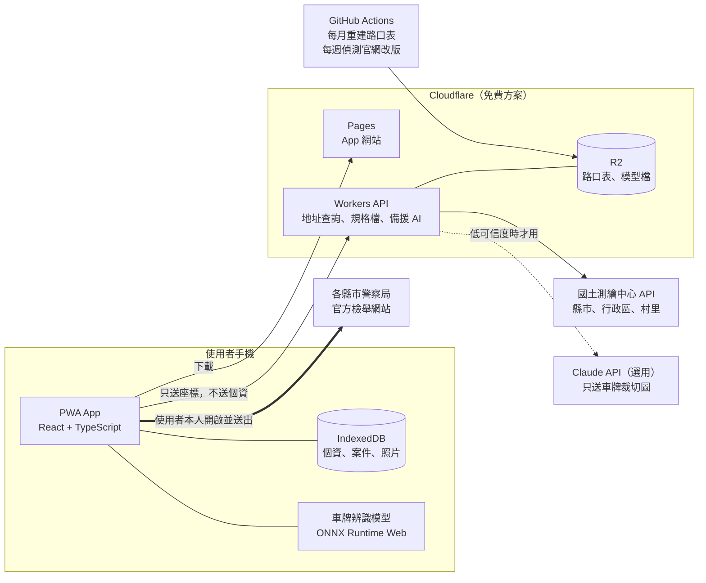

# 違停檢舉輔助系統：規劃設計書

| 項目 | 內容 |
|---|---|
| 版本 | v0.1（草案，待討論） |
| 日期 | 2026-10-17 |
| 範圍 | 第一階段先做臺北市和桃園市，架構預留擴充到全台 22 縣市 |
| 研究依據 | [`docs/RESEARCH.md`](RESEARCH.md)，裡面有完整來源與查證狀態 |

---

## 目錄

1. [摘要](#1-摘要)
2. [研究得到的關鍵事實](#2-研究得到的關鍵事實)
3. [產品定位與原則](#3-產品定位與原則)
4. [使用流程](#4-使用流程)
5. [功能需求](#5-功能需求)
6. [系統架構](#6-系統架構)
7. [關鍵技術設計](#7-關鍵技術設計)
8. [資料模型](#8-資料模型)
9. [隱私、資安與法遵](#9-隱私資安與法遵)
10. [工程實務](#10-工程實務)
11. [開發路線圖](#11-開發路線圖)
12. [費用估算](#12-費用估算)
13. [風險與對策](#13-風險與對策)
14. [需要決定的事項](#14-需要決定的事項)
15. [下一步](#15-下一步)

---

## 1. 摘要

**目標**：在人行道或斑馬線上看到違停的汽車，拍完照之後 **1 分鐘內**就能把整件檢舉準備好，最後由本人在官方網站送出。

**做法**：
- 個人資料只填一次，存在自己的手機裡。
- 違規時間、地點、車牌、適用法條、違規事實說明都自動產生，由使用者確認。
- 送出前先檢查：這件能不能檢舉？證據夠不夠？有沒有超過 7 天？
- 依照各縣市官方表單的欄位順序和選項文字，提供「一鍵複製」。第二階段再做「自動填表」。
- 最後的身分驗證、驗證碼、送出，都由本人完成。

**建議路線**：
1. 先做手機網頁 App（PWA，加到主畫面後用起來像一般 App）。
2. 再加自動填表，並擴充到全台。
3. 最後做原生 App，上架 App Store 和 Google Play。

第一階段的費用**接近 0 元**。

**研究中最重要的五個發現**：

1. **只有「四輪以上汽車」停在「騎樓以外的人行道」或「斑馬線」上可以檢舉。** 機車、騎樓、紅黃線、路口違停都不能檢舉。所以系統要先替使用者判斷，避免白做工。
2. **證據要拍到駕駛座。** 要以「停車」舉發，最好再隔 3 分鐘以上從同一角度補拍一張。只拍一張容易被認定成臨時停車而勸導免罰。所以系統要有「拍攝引導」和「3 分鐘計時器」。
3. **全國沒有統一的檢舉平台。** 22 縣市大多各自不同，但結構很像，都是「行政區下拉 → 路段下拉 → 補充文字」加上「法條下拉」。所以適合用「縣市規格資料化」的架構：新增一個縣市只要加一份設定檔，不用改程式。
4. **iPhone 用網頁上傳照片時，GPS 預設會被拿掉。** 所以要同時提供三種取得位置的方式：App 內拍照時抓定位、從相簿選照片時打開「位置」選項、在地圖上手動修正。
5. **已經有類似的 App「檢舉大師」。** 本專案的差異是：專注行人路權、拍攝引導、可檢舉判斷器、全台規格庫、免費、隱私優先。

---

## 2. 研究得到的關鍵事實

詳細內容和來源見 [`RESEARCH.md`](RESEARCH.md)。這裡只列直接影響設計的部分。

### 2.1 能檢舉的範圍（2024-06-30 施行的版本）

| 情境 | 可否檢舉 | 系統怎麼處理 |
|---|---|---|
| 四輪以上汽車停在人行道上（騎樓外） | ✅ 第 56 條第 1 項第 1 款，小型車 900 元 | 主要功能 |
| 四輪以上汽車停在斑馬線上 | ✅ 同上 | 主要功能 |
| 上面兩種情境，但駕駛人在車上（臨時停車） | ✅ 第 55 條第 1 項第 1 款，600 元，但證據要求高 | 提醒要拍到停車與駛離 |
| 機車停在人行道或斑馬線 | ❌ | 告訴使用者不能檢舉，建議打 110 |
| 停在騎樓 | ❌ | 同上 |
| 紅黃線、路口、公車站 | ❌ | 同上 |
| 占用身障車位、併排停車 | ✅ | 第二階段加入 |

### 2.2 必須遵守的規則

- **7 天期限**：違規當天算第 1 天。系統要顯示倒數，並提供提醒。
- **6 分鐘規則**：同一輛車 6 分鐘內、沒有經過一個路口的違規只算一次。系統要用自己的紀錄比對，避免重複檢舉。
- **實名制**：姓名、身分證、住址、電話都要正確，否則不受理。
- **原始檔**：不收雲端連結。照片要看得出拍攝日期和時間。

### 2.3 臺北和桃園的系統差異

| | 臺北市 | 桃園市 |
|---|---|---|
| 網址 | prsweb.tcpd.gov.tw | tvrweb.typd.gov.tw:3444 |
| 圖形驗證碼 | **沒有** | 有（5 碼） |
| Email 認證 | 有，**同一信箱只要認證一次** | 有（每次是否都要，待確認） |
| 欄位資料 | **完整**（2026-09 實測） | 只有第一步。**第二步要本人實際操作才看得到** |
| 上傳 | 5 檔、總共 80MB、**不收 HEIC** | 待確認 |

---

## 3. 產品定位與原則

### 3.1 目標使用者

| 類型 | 描述 | 需求 |
|---|---|---|
| A. 你本人（第一位使用者） | 走路或通勤時常看到違停，想檢舉但覺得麻煩 | 快、不用重複填資料 |
| B. 一般民眾 | 在意行人安全，不熟法規也不熟科技 | 簡單、會告訴我能不能檢舉、證據怎麼拍 |
| C. 倡議團體或社區 | 關心特定路段的人行道被占用 | 自己的紀錄與統計（之後再做） |

### 3.2 設計原則

1. **最後由本人送出**：不代送、不繞過驗證碼、不自動點認證信。這樣合法、可長久經營，警方也不會封鎖。
2. **隱私優先**：個人資料和照片只存在使用者手機。伺服器不保存任何個人資料。
3. **有效檢舉**：只引導可以檢舉的違規。證據不足時先提醒，目標是提高成案率，而不是增加件數。
4. **自動化要誠實**：每一個自動判讀都標示來源（照片資料、GPS、AI）和可信度，由使用者確認。
5. **免費優先**：能在手機上算的就在手機上算，優先使用免費的政府 API。
6. **能擴充**：縣市規格、法條規則、文字範本都寫成資料檔，不寫死在程式裡。
7. **單手、戶外好用**：大按鈕、高對比，在大太陽下也看得清楚。

### 3.3 刻意不做的事

- 代送檢舉，或繞過任何驗證。
- 排行榜、件數獎勵這類會鼓勵大量檢舉的設計。
- 公開任何車牌或照片。
- 第一階段不處理行車記錄器影片和「不停讓行人」這類動態違規，第四階段再評估。

### 3.4 和競品的差異

| | 本專案 | 檢舉大師 | FixTW |
|---|---|---|---|
| 送出方式 | 本人送出 | 本人送出 | 代送 |
| 可檢舉判斷與證據檢查 | ✅ 核心功能 | 部分 | ❓ |
| 拍攝引導、3 分鐘計時 | ✅ | ❓ | ❌ |
| 車牌辨識 | ✅ 在手機上辨識 | ❓ | ❌ 手動輸入 |
| 費用 | 免費 | ❓ | 有免費額度 |
| 個資存放 | 只在手機 | 只在裝置 | 存在服務端 |

**建議你先下載「檢舉大師」實際用一次。** 如果它已經完全符合你的需求，可以重新考慮要不要自己開發；如果有不足的地方，那些就是本專案的機會。

---

## 4. 使用流程

### 4.1 第一次使用（約 3 分鐘）

1. 用 Safari 打開 App 網址，按「分享」→「加入主畫面」。
   - 這一步很重要：iOS 只有加到主畫面的 App，資料才不會在 7 天沒用之後被清掉。
2. 看一頁說明：可以檢舉什麼、資料存在哪裡。
3. 填個人資料：姓名、身分證字號、電話、地址、Email。
4. 允許定位權限。
5. 選擇是否設定 App 鎖（PIN 或 Face ID）。

### 4.2 主要流程：現場拍照模式

```
看到違停
  │
  ▼
① 打開 App，按「新增檢舉」
  │
  ▼
② 先回答一題：車子是「汽車」還是「機車」？停在「人行道」、「斑馬線」還是「騎樓」？
   → 機車或騎樓：顯示「這種情況目前不能由民眾檢舉，可以打 110」，流程結束
  │
  ▼
③ 拍攝引導（App 內相機，每拍一張都記錄 GPS 和時間）
   □ 照片 1：全景，看得出車停在人行道或斑馬線上，最好拍到路名牌或門牌
   □ 照片 2：車牌特寫
   □ 照片 3：駕駛座，看得出有沒有人
   ⏱ 3 分鐘計時器開始倒數（選擇性）
   □ 照片 4：3 分鐘後從同一角度再拍一張，用來證明是「停車」而不是「臨時停車」
  │
  ▼
④ 自動判讀（大約 2–5 秒）
   • 時間：2026/10/17 14:32
   • 地點：臺北市大安區 忠孝東路四段 100 號前（地圖上可以拖曳修正）
   • 管轄：臺北市政府警察局（大安分局轄區）
   • 車牌：ABC-1234（可信度 92%，另列兩個候選）
   • 違規事實：汽車於人行道、行人穿越道停車（第 56 條第 1 項第 1 款）
   • 證據檢查：✅ 車牌 ✅ 駕駛座 ✅ 3 分鐘間隔 ⚠️ 沒拍到路名牌
   • 期限：還有 7 天（10/23 24:00 前）
  │
  ▼
⑤ 確認畫面：每一欄都可以修改，按「確認」
  │
  ▼
⑥ 送出輔助（第 4.4 節）
  │
  ▼
⑦ 回到 App，貼上或輸入「案件編號」和「查詢密碼」，案件標成「已送出」
```

### 4.3 其他模式

- **相簿模式**：用 iPhone 內建相機拍好，再從相簿選照片。
  - 選照片時，App 會教使用者點選取畫面上的「選項」並打開「位置」。
  - 如果照片沒有 GPS，就請使用者在地圖上點選位置。
- **批次模式**（第二階段）：走一段路拍了好幾台車，一次匯入所有照片。系統依車牌、時間、位置自動分成多件，再逐件確認。
- **稍後再送**：先存成草稿，首頁顯示「還有 N 天到期」。可以把提醒加入 iPhone 行事曆，這不需要伺服器。

### 4.4 送出輔助（以臺北為例）

**第一階段：一鍵複製**

1. App 顯示「臺北市送出清單」，欄位順序和官方網站一模一樣。
   - 每一欄旁邊都有「複製」按鈕。
   - 下拉選單的欄位，直接顯示要選的那一項文字，例如「行政區：大安區」「違規事實：汽車於人行道、行人穿越道停車(但機車及騎樓不在此限)」。
2. 按「開啟臺北市檢舉網站」。
3. 第一次使用時，按「發送認證信」，到信箱點連結。之後同一個信箱就不用再認證。
4. 依序貼上各欄。
5. 上傳照片：App 已經準備好符合規定的 JPEG 檔，最多 5 張，存在「照片」App 的專用相簿。
6. 本人按送出。
7. 把案件編號和查詢密碼記回 App。

**第二階段：自動填表**

- 在官方網頁上按一下，個人資料、日期、地點、車牌、違規事實就全部填好。
- 使用者只要上傳照片、處理驗證，然後按送出。做法比較見第 7.7 節。

### 4.5 案件追蹤

| 狀態 | 說明 |
|---|---|
| 草稿 | 已拍照，還沒送出，顯示期限倒數 |
| 已送出 | 有案件編號和查詢密碼，可以一鍵開啟官方查詢頁 |
| 已舉發／不舉發／勸導 | 使用者自己更新結果，用來累積「哪種證據比較容易成案」的經驗 |

---

## 5. 功能需求

優先度說明：P0 是第一版一定要有；P1 是第二階段；P2 是之後再做。

| 編號 | 功能 | 說明 | 優先度 |
|---|---|---|---|
| F1 | 個人資料 | 只填一次，存在手機（IndexedDB）；可以選擇加密並用 PIN 或 Face ID 解鎖；可以匯出備份 | P0 |
| F2 | 可檢舉判斷器 | 用 2–3 個問題（車種、停放位置、駕駛在不在）判斷能不能檢舉、適用哪一條 | P0 |
| F3 | App 內相機 | 拍照當下記錄 GPS、精度、時間；依清單引導拍攝 | P0 |
| F4 | 相簿匯入 | 用 ExifReader 讀取拍攝時間和 GPS；缺 GPS 時教使用者打開「位置」選項，或改用地圖 | P0 |
| F5 | 3 分鐘計時器 | 拍完第一張開始倒數，時間到提醒補拍 | P0 |
| F6 | 地點判讀 | GPS 轉成縣市、行政區、路段、門牌或路口；可以在地圖上拖曳修正 | P0 |
| F7 | 管轄判斷 | 依違規地點（不是檢舉人住址）決定送哪個機關；處理國道、科學園區、機場等特殊轄區；臺北要判斷中正、文山的一區或二區 | P0 |
| F8 | 車牌辨識 | 在手機上用 ONNX 模型辨識；用台灣車牌規則校正；列 3 個候選，由使用者確認 | P0 |
| F9 | 證據檢查 | 檢查有沒有車牌、駕駛座、時間間隔、地標；不足時提醒 | P0 |
| F10 | 違規事實說明產生 | 依範本產生，臺北限 200 字以內，可以修改 | P0 |
| F11 | 送出清單與一鍵複製 | 依各縣市欄位順序和選項文字顯示 | P0 |
| F12 | 照片準備 | 轉成 JPEG、符合大小限制、檔名只用英文數字 | P0 |
| F13 | 案件管理 | 草稿、期限倒數、已送出、案件編號、結果 | P0 |
| F14 | 重複檢舉防呆 | 同車牌、同地點、6 分鐘內的案件會提醒 | P0 |
| F15 | 行事曆提醒 | 產生 .ics 檔加入行事曆，不需要伺服器 | P1 |
| F16 | 自動填表 | 見 7.7 節 | P1 |
| F17 | 全台 22 縣市規格 | 匯入 iroowu 的規格資料，逐一驗證 | P1 |
| F18 | 批次模式 | 一次匯入多張照片並自動分案 | P1 |
| F19 | 身障車位、併排停車 | 擴充違規類型 | P1 |
| F20 | 官方網站改版偵測 | 每週自動檢查各縣市網站有沒有改版，有就通知 | P1 |
| F21 | 原生 App | iOS 和 Android，見 6.5 節 | P2 |
| F22 | 個人統計、匿名熱點地圖 | 使用者自願提供，用於倡議 | P2 |
| F23 | 動態違規（不停讓行人） | 處理影片 | P2 |

### 非功能需求

| 項目 | 目標 |
|---|---|
| 速度 | 從選好照片到所有欄位準備好，iPhone 12 以上 **5 秒內** |
| 正確率 | 地點正確到路段：≥ 95%；車牌：前 3 個候選包含正確答案 ≥ 95%（使用者確認後是 100%） |
| 離線 | 沒網路也能拍照、存草稿；有網路時再補地址判讀 |
| 無障礙 | 符合 WCAG 2.2 AA；按鈕至少 44×44 pt；支援深色模式 |
| 語言 | 繁體中文，之後加英文 |

---

## 6. 系統架構

### 6.1 架構總覽



**重點：個人資料、照片、案件紀錄只存在手機。** 伺服器只收到座標（用來查地址），以及使用者選擇開啟備援 AI 時的車牌裁切小圖。這兩樣都不保存。

### 6.2 前端：PWA

| 項目 | 選擇 | 原因 |
|---|---|---|
| 語言 | TypeScript | 型別安全，前後端可以共用程式碼 |
| 框架 | React 19 + Vite | 生態系成熟，之後可以和 React Native 共用元件和邏輯 |
| 本機儲存 | IndexedDB（用 Dexie 套件） | 能存照片這類大檔案 |
| 離線與快取 | Service Worker（Workbox） | 離線可用，模型檔下載一次後就快取 |
| 照片資料 | ExifReader | 支援 iPhone HEIC，持續維護中 |
| 車牌辨識 | onnxruntime-web | 優先用 WebGPU，不支援時改用 WASM |
| 地圖 | MapLibre GL，搭配國土測繪中心「臺灣通用電子地圖」圖磚 | 免費，台灣地圖最準（使用條款待確認） |
| 介面 | Tailwind CSS 與自建元件 | 輕量、好維護 |
| 加密 | Web Crypto（AES-GCM） | 瀏覽器內建 |

### 6.3 後端：Cloudflare Workers

這裡沒有資料庫，也不存任何個人資料。

| API | 功能 |
|---|---|
| `GET /v1/geo/reverse?lat=&lng=` | 座標轉地址：國土測繪中心查行政區，自建路口表查路名和路口；結果短暫快取 |
| `GET /v1/jurisdictions` | 回傳縣市規格檔（有版本號）。官網改版時更新這份檔案，**不用重新發布 App** |
| `POST /v1/plate/fallback` | 選用功能：車牌裁切圖交給 Claude Haiku 辨識。有防機器人驗證（Turnstile）和每日上限 |
| `GET /v1/health` | 健康檢查 |

### 6.4 資料處理流程（GitHub Actions 定期執行）

1. **路口表**：每月下載台灣的 OSM 資料，找出所有路口（兩條不同名的道路交會的點），依地理格子分片存到 R2。
2. **官網改版偵測**：每週抓取各縣市檢舉網站的頁面和程式檔，算出雜湊值和上次比較。有變化就自動開 Issue 通知。
3. **規格驗證**：每次修改縣市規格檔，自動用 JSON Schema 檢查格式。

### 6.5 原生 App（第三階段）

用 **Expo（React Native）** 一套程式碼同時做 iOS 和 Android，並共用第一、二階段寫好的核心程式碼。

| 能力 | PWA | 原生 App |
|---|---|---|
| 讀照片 GPS | 有限制（要開「位置」選項） | ✅ PhotoKit 直接讀 |
| 從「照片」App 分享進來 | ❌ | ✅ |
| 文字辨識 | ONNX 模型 | ✅ Apple Vision（免費、準確） |
| 自動填表（含上傳照片） | 有限制 | ✅ 內嵌瀏覽器可以全部填好 |
| 推播提醒 | 要伺服器 | ✅ 本機通知 |
| 上架費用 | 免費 | Apple 每年 US$99、Google 一次 US$25 |

### 6.6 專案資料夾結構（monorepo）

```
parking-report-helper/
├── apps/
│   ├── web/              PWA（第一階段）
│   ├── autofill/         自動填表工具（第二階段）
│   └── mobile/           Expo 原生 App（第三階段）
├── services/
│   └── api/              Cloudflare Worker
├── packages/
│   ├── core/             共用核心：型別、規則引擎、期限計算、文字範本
│   ├── jurisdictions/    22 縣市規格（JSON + Schema + 測試）
│   ├── violations/       可檢舉違規與法條規則
│   ├── geo/              地址判讀、路口查詢、管轄判斷
│   └── plate/            車牌辨識流程、台灣車牌規則
├── tools/
│   ├── build-intersections/   路口表建置腳本
│   └── site-monitor/          官網改版偵測
├── fixtures/             測試用照片（含 GPS）、官網頁面快照
└── docs/
    ├── PLAN.md           本文件
    ├── RESEARCH.md       研究彙整
    └── adr/              架構決策紀錄
```

- 工具：pnpm workspaces 加 Turborepo。
- 設計重點：`packages/` 裡的程式都**不依賴任何畫面**，可以單獨測試，PWA 和原生 App 共用。

---

## 7. 關鍵技術設計

### 7.1 照片的時間與位置

各種來源的優先順序：

| 優先 | 來源 | 可靠度 | 備註 |
|---|---|---|---|
| 1 | App 內相機加 `navigator.geolocation` | 高 | 同時記錄 GPS 精度（例如 ±8 m） |
| 2 | 照片 EXIF：`DateTimeOriginal` + `OffsetTimeOriginal` + GPS | 高 | 從相簿選照片時要打開「位置」選項 |
| 3 | 使用者在地圖上點選 | 中 | 標記為「手動」 |
| 4 | 檔案修改時間 `file.lastModified` | 低 | 只能當最後手段，並提醒使用者核對 |

**合理性檢查**：
- 照片超過 7 天：警告。
- GPS 不在台灣範圍：警告。
- GPS 精度大於 50 m：建議在地圖上確認。
- 多張照片的位置相差超過 100 m：提醒可能不是同一件。

### 7.2 地址判讀

```
座標 (25.0418, 121.5440)
  │
  ├─①→ 縣市、行政區、村里   國土測繪中心 API（免費，或用內建的行政區界線離線判斷）
  │
  ├─②→ 最近的道路和路口     自建 OSM 路口表（Worker 從 R2 讀取）
  │      30 m 內有路口 →「忠孝東路四段與敦化南路一段口」
  │      否則           →「忠孝東路四段」
  │
  ├─③→ 最近的門牌           縣市門牌開放資料（臺北有；桃園待找）
  │      →「100 號前」
  │
  └─④→ 對應到官方表單的選項
         • 臺北「行政區」選單：中正和文山要依「警察分局轄區」分成一區或二區
         • 臺北「路段」選單：把路名正規化後模糊比對（臺／台、段的數字寫法）
         • 表單的「巷弄號／交叉路口／地點備註」三選一：有門牌填門牌，在路口就選交叉路口
```

**備援**：自建結果可信度不足時，改呼叫 Google Geocoding（每月 1 萬次免費）。

**一律可修改**：地圖上的大頭針可以拖曳，地址欄也可以直接打字。

### 7.3 車牌辨識

```
照片
 → ① 偵測車牌位置（YOLOv9-t，約 8MB）
 → ② 裁切並校正
 → ③ 辨識文字（fast-plate-ocr，約 3–5MB）
 → ④ 依台灣車牌規則校正（例如 O→0、I→1，新式車牌英文不會出現 I、O）
 → ⑤ 前 3 個候選加上可信度
 → ⑥ 可信度低於門檻時：
      • 如果使用者有開啟，就把「裁切後的車牌小圖」交給 Claude Haiku（每張約 0.005 元台幣）
      • 否則請使用者自己輸入
 → ⑦ 使用者確認（必要步驟）
```

**關於你問的「用你這邊（Claude）或 GPT 讀車牌，省額度」**：
- Claude 的訂閱方案（例如 Pro）**沒辦法讓 App 呼叫**。App 要用的是另外計費的 API，但非常便宜：每張約 US$0.00015，1 萬張大約 US$1.5–3。
- GPT 的 API 一樣要付費，沒有確定的免費額度。
- Gemini 有免費額度，但免費層的資料可能被拿去訓練模型。照片裡有別人的車牌和位置，**不適合用在公開服務**。
- 所以建議：**主力用手機上的免費模型，AI 只當備援，而且只送車牌的小圖。**

**待驗證的風險**：免費模型的訓練資料不含台灣車牌，準確率要實測。計畫如下：
1. 第 0 階段：收集 30–50 張你拍的真實照片，先做初步測試。
2. 準確率不夠時：收集 200–500 張台灣車牌照片，用 fast-plate-ocr 官方的教學再訓練（MIT 授權，可商用）。
3. 不使用 AGPL 授權的 Ultralytics YOLO，避免授權問題。

### 7.4 可檢舉判斷與證據檢查（規則引擎）

規則寫成資料檔，法規改了只要改資料：

```yaml
# packages/violations/rules/sidewalk-parking.yaml（示意）
id: sidewalk_parking
name: 汽車於人行道停車
law: { article: 56, paragraph: 1, subparagraph: 1 }
reportable: true
reportable_basis: 道交條例第 7 條之 1 第 1 項第 16 款
conditions:
  vehicle_class: [car]              # 機車 → 不可檢舉
  location_type: [sidewalk]         # 騎樓 → 不可檢舉
  driver_present: false             # 駕駛在車上 → 改走臨時停車規則
fine: { car_small: 900, car_large: 1200 }
evidence:
  required:
    - plate_visible          # 車牌清楚
    - violation_context      # 看得出在人行道上
    - driver_seat            # 拍到駕駛座
  recommended:
    - interval_3min          # 間隔 3 分鐘以上的同角度照片
    - landmark               # 路名牌或門牌
jurisdiction_labels:
  taipei: 汽車於人行道、行人穿越道停車(但機車及騎樓不在此限)
effective_from: 2024-06-30
sources:
  - https://law.moj.gov.tw/LawClass/LawAll.aspx?pcode=K0040012
```

判斷流程：

```
車種？ ─ 機車 → ❌ 不可檢舉（建議打 110）
  │
 汽車
  │
停放位置？ ─ 騎樓／紅黃線／路口 → ❌ 不可檢舉
  │
 人行道（騎樓外）／斑馬線
  │
駕駛在車上？ ─ 是 → 臨時停車（55-1-1）：提醒要拍到停車和駛離
  │
 否／不確定 → 停車（56-1-1）：檢查證據 → 列出缺少的項目
```

### 7.5 違規事實說明（文字範本）

用固定範本產生，不需要 AI，結果穩定、可以預測：

```
{車種} {車牌} 停放於{地點}之{人行道|行人穿越道}上，駕駛座無人，
占用{人行道|行人穿越道}妨礙行人通行。
照片 1 為全景、照片 2 為車牌、照片 3 為駕駛座，照片 4 為 {間隔} 分鐘後同一位置。
```

範例（約 110 字，符合臺北 200 字的上限）：

> 自用小客車 ABC-1234 停放於臺北市大安區忠孝東路四段 100 號前之人行道上，駕駛座無人，占用人行道妨礙行人通行。照片 1 為全景、照片 2 為車牌、照片 3 為駕駛座，照片 4 為 4 分鐘後同一位置。

### 7.6 縣市規格（資料化）

每個縣市一份規格檔，用 JSON Schema 驗證：

```jsonc
// packages/jurisdictions/specs/taipei.json（示意）
{
  "id": "taipei",
  "name": "臺北市",
  "agency": "臺北市政府警察局",
  "spec_version": "2026-09-26",
  "last_verified": "2026-09-26",
  "url": "https://prsweb.tcpd.gov.tw/",
  "auth": { "captcha": false, "email_verify": "once_per_email", "email_verify_ttl_min": 30 },
  "fields": [
    { "key": "reporter.id_number", "label": "身分證或居留證號", "required": true },
    { "key": "reporter.name",      "label": "姓名",             "required": true },
    { "key": "case.date",          "label": "違規日期", "type": "select", "range_days": 7 },
    { "key": "case.time",          "label": "違規時間", "format": "HH:mm" },
    { "key": "case.district",      "label": "行政區",   "type": "select",
      "options": ["中正一區","中正二區","大同區","中山區","松山區","大安區","萬華區",
                  "信義區","士林區","北投區","內湖區","南港區","文山一區","文山二區","捷運站"] },
    { "key": "case.road",          "label": "路段",     "type": "select-search" },
    { "key": "case.location_detail", "label": "巷弄號／交叉路口／地點備註", "one_of": true },
    { "key": "case.plate",         "label": "車號",     "type": "plate-2-part" },
    { "key": "case.violation",     "label": "違規事實", "type": "select" },
    { "key": "case.description",   "label": "違規事實說明", "max_length": 200 }
  ],
  "upload": { "max_files": 5, "max_total_mb": 80,
              "formats": ["jpg","jpeg","png","bmp","tiff","mov","wmv","avi","mp4","3gp","ts"] },
  "result": { "case_number_prefix": "TP", "has_query_password": true },
  "sources": ["https://prsweb.tcpd.gov.tw/"]
}
```

- **起點**：匯入 iroowu 專案的 22 縣市資料（MIT 授權，要註明出處）。
- 每個縣市標示驗證狀態：`verified`（實際操作確認過）、`partial`（部分確認）、`unverified`（未確認）。
- 官網改版偵測發現變化時，規格標成「待重新驗證」，App 會顯示提醒。

### 7.7 自動填表（第二階段）的做法比較

各縣市網站屬於不同網域，基於瀏覽器的安全限制，一般網頁 App 不能直接填寫它們的表單。可行的方式有：

| 做法 | 原理 | 優點 | 缺點 | 建議 |
|---|---|---|---|---|
| A. iOS 捷徑「在網頁上執行 JavaScript」 | 在 App 按「複製填表資料」，到官方網頁按「分享」→ 執行捷徑，就自動填好 | 免費、不需要伺服器、iPhone 內建 | 要安裝捷徑；不能自動上傳照片 | **iPhone 首選** |
| B. Userscripts（Safari 擴充功能，免費開源） | 官方網頁上出現「貼上檢舉資料」按鈕 | 體驗好 | 要另外安裝擴充功能 | 進階使用者 |
| C. 書籤小程式（bookmarklet） | 在官方網頁點書籤 | 什麼都不用裝 | iPhone 上操作不方便 | 電腦版 |
| D. 原生 App 內嵌瀏覽器 | App 直接開官方網頁並填好，**連照片都能自動選好** | 體驗最好 | 要做原生 App | **第三階段** |

所有做法都遵守：**不填驗證碼、不自動點認證信、不自動按送出。**

臺北的網站是 Vue 寫的單頁應用，填入欄位後要觸發對應的 `input` 和 `change` 事件；「路段」是可搜尋的自訂下拉選單，要另外處理。這些都要用官網的頁面快照寫成自動化測試。

### 7.8 照片處理

- **原始檔不修改**：證據要用原始檔，App 永遠保留原始照片。
- **格式**：臺北不收 HEIC，所以要準備 JPEG 版本。iPhone 選照片時通常會自動轉檔，沒轉的話由 App 轉。
- **大小**：依各縣市規格壓縮，例如臺北 5 張合計 80MB。
- **檔名**：只用英文和數字，例如 `TP_20261017_1432_1.jpg`。
- **時間浮水印**：多個縣市要求畫面上要看得到時間。
  - App 內相機拍照時，直接在畫面角落壓上日期、時間和地點，這張就是原始採證檔。
  - 相簿照片保留原檔；使用者可以選擇另外產生一張壓印版。
  - 這點列為待決定事項 D3。

### 7.9 效能與離線

- 模型檔在第一次使用時下載（約 11–13MB），之後快取在手機。
- 沒有網路時：拍照、車牌辨識、草稿都能用；地址判讀等有網路時再補。
- 照片在手機上縮小後再辨識，降低記憶體用量。

---

## 8. 資料模型

```ts
// packages/core/src/types.ts（示意）

/** 檢舉人資料：只存在手機，可以加密 */
interface ReporterProfile {
  name: string;
  idNumber: string;          // 身分證或居留證號
  phone: string;
  email: string;
  address: string;
  updatedAt: string;
}

/** 證據照片 */
interface Evidence {
  id: string;
  role: 'overview' | 'plate' | 'driver_seat' | 'interval' | 'other';
  blobKey: string;           // 原始檔在 IndexedDB 的鍵值
  sha256: string;            // 原始檔雜湊，用來證明沒有被修改
  takenAt: string;           // ISO 8601，含時區
  takenAtSource: 'camera' | 'exif' | 'manual' | 'file_mtime';
  geo?: { lat: number; lng: number; accuracyM?: number; source: 'device' | 'exif' | 'manual' };
}

/** 地點 */
interface CaseLocation {
  county: string;            // 臺北市
  town: string;              // 大安區
  road?: string;             // 忠孝東路四段
  houseNumber?: string;      // 100號
  intersection?: [string, string];
  description: string;       // 組合後的地點文字
  lat: number; lng: number;
  confidence: number;        // 0–1
}

/** 一件檢舉 */
interface ReportCase {
  id: string;
  status: 'draft' | 'ready' | 'submitted' | 'cited' | 'not_cited' | 'warned' | 'expired';
  jurisdictionId: string;    // taipei / taoyuan / ...
  violationRuleId: string;   // sidewalk_parking / crosswalk_parking / ...
  vehicle: { plate: string; plateConfidence: number; class: 'car' | 'motorcycle' | 'unknown'; color?: string };
  location: CaseLocation;
  occurredAt: string;
  deadlineAt: string;        // 違規當天算第 1 天，第 7 天 24:00
  description: string;
  evidence: Evidence[];
  evidenceCheck: { item: string; ok: boolean }[];
  submission?: { submittedAt: string; caseNumber?: string; queryPassword?: string };
  createdAt: string; updatedAt: string;
}
```

---

## 9. 隱私、資安與法遵

### 9.1 資料分類與處理方式

| 資料 | 存在哪裡 | 會傳出去嗎 |
|---|---|---|
| 個人資料（姓名、身分證、電話、地址、Email） | 只在手機，可加密 | **不會**。只有使用者自己複製或自動填入官方網站 |
| 照片 | 只在手機 | 不會自動傳出。使用者按下「開始判讀」時，才會交給**使用者自己的 Claude 帳號**判讀；平台在傳送前會移除位置等中繼資料，本系統不保存。上傳到官方網站由使用者自己操作 |
| 座標 | 手機 | 會傳給 Worker 和國土測繪中心查地址，**不保存** |
| 車牌裁切小圖 | 手機 | 只有在使用者開啟 AI 備援時才傳給 Claude API，**不保存** |
| 案件紀錄 | 只在手機 | 不會。可以匯出備份檔 |

### 9.1.1 個人資料隔離（v0.2.1 起）

| 層級 | 做法 |
|---|---|
| 1. 不經過開發對話 | 使用者在 App 裡填的資料只存在自己的手機，開發用的 Claude 對話看不到 |
| 2. 不送 Claude | 送給 Claude 的只有：照片（使用者按「開始判讀」時）、陳情信的地點與日期、法規問題。個人資料一律不送 |
| 3. 加密存放 | 可設定「隱私密碼」：個人資料用 AES-GCM 加密，金鑰由 PBKDF2-SHA256 60 萬次產生；密碼與金鑰不儲存，只在解鎖期間留在記憶體。自動上鎖時間可選：離開 5 分鐘、30 分鐘（預設）、只在關掉 App 時（v0.3） |
| 4. 最少儲存 | 可選擇「不儲存身分證字號」，每次在官方網站自己輸入 |
| 5. 用完即清 | 自動填表後提供「清除剪貼簿」 |
| 6. 備份也加密 | 有隱私密碼時，備份檔裡的個人資料是加密的 |
| 7. 可檢查 | 程式碼在 GitHub，公開版預計開源，任何人都能確認沒有把個資傳出去 |
| 8. 照片不外流（v0.3） | App 相機和相簿的照片原檔存在 App 自己的資料庫（IndexedDB），不進手機相簿、不上傳；依設定自動刪除。只有使用者按「存到檔案」時才交給手機，由使用者決定存到 iCloud、Google 雲端硬碟或其他地方 |
| 9. 生物辨識（規劃） | Face ID／指紋只用 WebAuthn PRF 在手機安全晶片裡產生解鎖金鑰，網頁只拿到金鑰、拿不到臉或指紋資料；不只當作「開關」。密碼保留為備用。Claude App 的嵌入頁面通常不允許，排在私人網站版（v0.4） |

### 9.2 資安措施

- 全站 HTTPS，設定嚴格的內容安全政策（CSP）。
- **不放任何第三方追蹤碼或廣告。**
- 個人資料可以用 Web Crypto（AES-GCM）加密，金鑰由 PIN 或 Passkey 產生。
- 用 GitHub Dependabot 掃描套件漏洞。
- API 加上 Cloudflare Turnstile 防機器人，並限制請求頻率。
- 金鑰存在 Cloudflare 的密鑰設定裡，不放進程式碼。

### 9.3 法規與授權

- **個資法**：公開上線前要寫隱私權政策和使用條款。因為系統本身不蒐集個資，法遵負擔很低，但仍建議請法律專業人士看過。
- **檢舉相關**：
  - App 一律由本人送出。
  - 送出前顯示提醒：「請確認資料真實，偽造證據可能涉及刑責」。
  - 提供重複檢舉防呆。
- **開源授權**：

| 授權 | 套件 | 處理方式 |
|---|---|---|
| MIT | fast-plate-ocr、iroowu 規格資料 | 可以使用，要註明出處 |
| MPL-2.0 | ExifReader | 不修改它的原始檔就可以使用 |
| ODbL | OSM 資料 | 要標示「© OpenStreetMap contributors」 |
| 政府資料開放授權 | 政府開放資料 | 要標示來源 |
| AGPL | Ultralytics 等 | **不使用** |

- **open-image-models 偵測模型**：權重的授權來源不明確，要先確認；必要時改用 MIT 授權的 YOLO 自己訓練。

### 9.4 倫理

- 不做排行榜、不公開車牌，避免變成騷擾工具。
- 首頁的定位是「守護行人路權」，而不是「檢舉賺業績」。

---

## 10. 工程實務

| 項目 | 做法 |
|---|---|
| 版本控制 | `main` 分支設保護，每項功能開分支並用 Pull Request 合併；commit 訊息採 Conventional Commits |
| 自動檢查 | GitHub Actions：程式風格檢查（lint）、型別檢查、測試、建置；每個 PR 自動部署一個預覽網址 |
| 部署 | 合併到 `main` 後自動部署到 Cloudflare Pages |
| 單元測試 | Vitest：規則引擎、期限計算、車牌規則、地址組合、規格驗證 |
| 端對端測試 | Playwright：用帶 GPS 的測試照片跑完整流程；用官網頁面快照測自動填表 |
| 規格合約測試 | 每份縣市規格都要通過 Schema 檢查，並和官網快照比對 |
| 車牌評估 | 維護一組台灣車牌測試集，每次更新模型都產生準確率報告 |
| 架構決策紀錄 | `docs/adr/`：每個重要技術決定寫一份，記下原因和替代方案 |
| 版本號 | 語意化版本（SemVer），並維護 CHANGELOG |
| 錯誤監控 | 選用 Sentry 免費方案，先過濾掉個人資料 |
| 使用統計 | 選用 Cloudflare Web Analytics（不用 cookie），使用者同意才開啟 |

---

## 11. 開發路線圖

時間是估計值，實際長短要看你能多快協助實測。

### 測試管道：Claude 私人 Artifact（2026-10-17 決定）

正式公開之前，所有測試都在 Claude 裡進行：

- 測試版做成 **Claude Artifact**，**只有擁有者看得到**。用手機登入 Claude 就能使用，不需要另外架網站。
- 程式碼放在本 repo 的 `prototype/`，每次修改都重新發布到同一個網址。
- 確定好用之後，再依第 6 節的架構搬到 Cloudflare 公開。

Artifact 環境的限制，以及測試版的對應做法：

| 限制 | 測試版的做法 |
|---|---|
| 不能在網頁裡開即時相機畫面、抓定位 | 用手機內建相機（`<input capture>`）拍照，照片存在 App 裡不進相簿，但不含 GPS；或「從相簿選照片」，從照片 EXIF 讀時間和 GPS（選照片時要打開「選項 → 位置」；2026-10-17 在 Claude iOS App 實測可用）。App 在第一次成功帶出定位前會一直提醒這個步驟 |
| 不能連外部 API（例如國土測繪中心） | 縣市、行政區用內建的內政部界線資料離線判斷；路名和門牌請 Claude 讀照片裡的路名牌、門牌，或自己輸入；提供「在地圖看路名」連結 |
| 不能自動填官方網站 | 依官方欄位順序一鍵複製 |
| 車牌辨識 | 用 Artifact 的 Claude 功能，**使用使用者自己的 Claude 帳號額度**；照片傳送前，平台會移除位置等中繼資料 |

### 第 0 階段：驗證與準備（約 1 週）

| 工作 | 誰做 | 產出 |
|---|---|---|
| 開放雲端環境的網路權限 | 你 | 我可以實際打開各縣市網站 |
| 建立 GitHub repo | 你（✅ 已完成） | — |
| **iPhone 定位測試頁**：測試你的手機從相簿選照片或在網頁內拍照時，能不能拿到 GPS | 我做測試頁，你用手機測 | 確定第一版要用哪種取得定位的方式 |
| **桃園第二步表單**：下次你在桃園檢舉時，用 iPhone 螢幕錄影把整個過程錄下來 | 你 | 補齊桃園規格 |
| 收集 30–50 張真實違停照片（車牌可以之後打碼） | 你 | 車牌辨識測試集 |
| 試用「檢舉大師」 | 你 | 競品比較 |
| 專案骨架：monorepo、CI、Cloudflare 部署 | 我 | 可以自動部署的空專案 |

### 第 1 階段：個人版 MVP（約 2–3 週）

- 包含功能 F1–F14，支援臺北市和桃園市。
- **驗收標準**：
  - 從選好照片到所有欄位準備好 ≤ 5 秒。
  - 你用它實際完成 10 件臺北或桃園的檢舉，過程順利。
  - 地點、車牌經你確認後全部正確。

### 第 2 階段：自動填表與全台（約 3–4 週）

- 包含功能 F15–F20：iOS 捷徑自動填表、22 縣市規格、批次模式、身障車位與併排停車、官網改版偵測。
- 車牌模型用台灣資料再訓練。
- 申請國土測繪中心門牌 API 或 TGOS。

### 第 3 階段：公開版（約 4–8 週）

- 用 Expo 做原生 App（iOS、Android），上架 App Store 和 Google Play。
- 決定品牌名稱、網域、隱私權政策、使用條款。
- 找 10–30 位封閉測試使用者（TestFlight）。

### 第 4 階段：進階功能

- 動態違規（不停讓行人）與影片處理。
- 使用者自願提供的匿名熱點地圖，可以交給倡議團體或市議員。
- 英文介面。

---

## 12. 費用估算

| 項目 | 第 1–2 階段 | 第 3 階段以後 |
|---|---|---|
| Cloudflare（網站、API、儲存） | 0 元 | 0 元起（超量後約 US$5/月） |
| 國土測繪中心 API | 0 元 | 0 元（門牌 API 待確認） |
| 車牌辨識（手機上） | 0 元 | 0 元 |
| AI 備援（選用） | 1 萬張約 US$1.5–3 | 同左 |
| Google 地址備援（選用） | 每月 1 萬次內 0 元 | 超過後每千次約 US$5 |
| 網域（選用） | 每年約 NT$400–1,200 | 同左 |
| Apple 開發者帳號 | — | 每年 US$99 |
| Google Play 開發者帳號 | — | 一次 US$25 |

---

## 13. 風險與對策

| 風險 | 可能性 | 影響 | 對策 |
|---|---|---|---|
| 各縣市官網改版，填表失效 | 高 | 中 | 規格資料化、每週偵測改版、App 顯示「規格待驗證」 |
| iPhone 網頁拿不到 GPS | 中 | 高 | 三種取得方式並行；第三階段改用原生 App |
| 車牌辨識不準（台灣車牌不在訓練資料內） | 中 | 中 | 一律由使用者確認；用台灣資料再訓練；AI 備援 |
| 法規再修改 | 中 | 高 | 規則資料化並註明生效日；每季檢查一次法規 |
| 桃園等縣市的第二步表單不明 | 確定 | 中 | 由你實際操作並錄影 |
| 社會觀感不佳（被看成檢舉蟑螂工具） | 中 | 中 | 定位為守護行人路權；不做排行；不公開車牌；以成案率為目標 |
| 警方限制自動化 | 低 | 高 | 不代送、不繞過驗證；自動填表只在使用者的瀏覽器裡進行 |
| 個資外洩 | 低 | 高 | 伺服器不存個資；手機端可以加密 |
| iOS 清掉網頁資料 | 中 | 中 | 引導加到主畫面、要求永久儲存權限、提供備份匯出 |
| 只有一人維護，負擔太重 | 中 | 中 | 規格資料化、自動化測試；公開版可以考慮開源，讓社群一起維護規格 |

---

## 14. 需要決定的事項

| 編號 | 問題 | 選項 | 我的建議 |
|---|---|---|---|
| D1 | 產品名稱 | 例如：「人行守護」「斑馬線守護者」「路權小幫手」，或你自己取 | 先用暫名，第 3 階段再定 |
| D2 | 公開版要不要開源 | 開源，或不開源 | **公開版開源**：讓大家相信不會偷存個資，也能請社群一起維護 22 縣市規格。開發期間先維持私人 |
| D3 | 時間浮水印 | App 內拍照時壓印／不壓印／讓使用者選 | **App 內拍照時壓印日期、時間、地點**，相簿照片保留原檔 |
| D4 | AI 車牌辨識 | 不用／用 Claude API（自己出錢，極便宜）／讓使用者填自己的金鑰 | **測試版已決定**：用 Claude Artifact 的 Claude 功能，使用使用者自己的帳號額度。公開版再評估 |
| D5 | 原生 App 的時程 | 第 3 階段／提前 | 照路線圖。如果第 0 階段測出 iPhone 網頁拿不到 GPS，就提前 |
| D6 | 是否支援電腦版 | 只做手機／手機加電腦 | 以手機為主，電腦版做基本支援 |

---

## 15. 下一步

**需要你做的**：
1. 回覆第 14 節的決定事項（可以只回答你有意見的）。
2. 開放雲端環境的網路權限，讓我能實際打開各縣市網站。
3. 下次在桃園檢舉時，用螢幕錄影把整個過程錄下來。
4. 平常看到違停時，多拍幾張照片留著（之後做測試集）。

**我接下來會做的**（你確認規劃後）：
1. 做「iPhone 定位測試頁」讓你測試。
2. 建立專案骨架：monorepo、CI、Cloudflare 自動部署。
3. 寫第一批架構決策紀錄（ADR）。
4. 開始第 1 階段 MVP。
